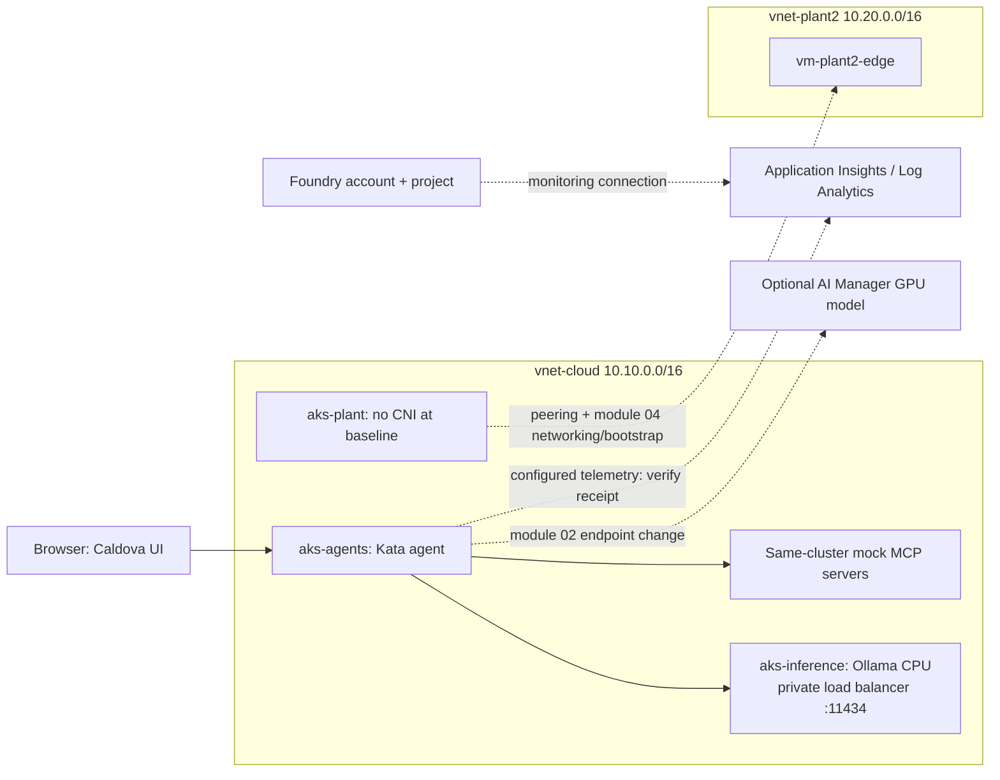

# Hands-on lab: Deploy and run Microsoft Foundry models and agents on AKS

A reproducible lab based on the Microsoft Ignite session **"Deploy and run Microsoft Foundry models and agents on AKS"** (Brendan Burns & Jorge Palma). It follows the session's story: **Caldova Pharmaceuticals**, a regulated manufacturer with 4 plants and 120 lines, wants an AI agent that cuts the time to troubleshoot production-line micro-stops. It has to run on the AKS infrastructure Caldova already has approved, under Caldova's control, across cloud and plant sites.

> `azd up` deploys the **infrastructure and CPU-based sample**. The modules then guide optional preview exercises (AI Manager, Flex nodes, Agent Sandbox, Agent Grid) and explain the access-gated Foundry own-AKS hosting boundary. A completed base deployment does not mean these previews are configured.

## Choose your learning track

| Track | Start here | What you will learn |
|---|---|---|
| **Portal experience** | [Portal modules 01–08](docs/portal/README.md) | Portal/browser steps, visual checkpoints and required terminal steps together in each module. No code-track detours. |
| **Code experience** | [Code modules 01–08](docs/code/README.md) | PowerShell/Bash, Bicep and Kubernetes workflows, with their own prerequisites, checkpoints and cleanup. |

Choose one track and stay in its folder from setup to cleanup. Both tracks describe **the same baseline deployment**; do not deploy it twice. Module 02 also explains the optional separate-region GPU deployment without moving the base. Learn the CPU agent/tool/model flow first, then change one layer at a time: model serving → hosting boundary → edge compute → isolation → network policy → evidence/cost. Preview exercises are optional and access-dependent. The Foundry own-AKS hosting path is an **access-gated discussion**, not a verified public walkthrough; the base is a plain FastAPI app on AKS.

Portal capabilities and preview requirements were checked against Microsoft documentation on **25 November 2026**. Each module links its authoritative references; the [portal source register](docs/portal/README.md#source-register) collects them. This is not a claim that every preview was deployed or tested.

## Architecture



The edge VM is not attached until module 04; the baseline uses the legacy Kata RuntimeClass, not the Kata v2 runtime required by the current Agent Sandbox guide. Each track explains these boundaries before its optional exercises.

## Session → lab map

| Session (approx.) | Topic | Portal | Code |
|---|---|---|---|
| 00:00–06:30 | AKS foundation, access and baseline preparation | [01](docs/portal/01-prerequisites.md) | [01](docs/code/01-prerequisites.md) |
| 06:30–09:00 | AI Manager: open-weight models on AKS | [02](docs/portal/02-aks-ai-manager.md) | [02](docs/code/02-aks-ai-manager.md) |
| 09:00–12:30 | Caldova production-line app and CPU baseline | [01](docs/portal/01-prerequisites.md#5-establish-the-browser-baseline) | [01](docs/code/01-prerequisites.md#checkpoint-and-recovery) |
| 12:30–15:00 | Foundry hosting boundary and access gates | [03](docs/portal/03-foundry-aks-compute.md) | [03](docs/code/03-foundry-aks-compute.md) |
| 15:00–19:00 | Multi-plant compute with Flex nodes | [04](docs/portal/04-flex-nodes.md) | [04](docs/code/04-flex-nodes.md) |
| 20:00–24:00 | Kata / Agent Sandbox | [05](docs/portal/05-pod-sandboxing-agent-sandbox.md) | [05](docs/code/05-pod-sandboxing-agent-sandbox.md) |
| 24:00–30:00 | Agent Grid and governed egress | [06](docs/portal/06-agent-grid.md) | [06](docs/code/06-agent-grid.md) |
| 30:00+ | Evidence and cost, followed by cleanup | [07](docs/portal/07-observability-cost.md) / [08](docs/portal/08-cleanup.md) | [07](docs/code/07-observability-cost.md) / [08](docs/code/08-cleanup.md) |

## Quick start

```powershell
# See module 01 in docs/code/ or docs/portal/ before running this new-environment example.
azd auth login            # or: azd config set auth.useAzCliAuth true
azd env new ignite-aks
azd env set AZURE_LOCATION swedencentral
azd up                    # ~25 min: infra + images + Ollama + agent (postprovision hook)
azd env get-value AGENT_URL
```

After the `pull-models` job completes, open `AGENT_URL`, pick **line-7** and run **Guided** first, then **Autonomous** troubleshooting. The agent:
1. reads live signals and alarms via the **plant-signals** MCP server,
2. searches the equipment manual and maintenance history via the **maintenance** MCP server,
3. proposes a root cause, a restart procedure and a work order draft.

**Guided** runs a fixed tool plan; **Autonomous** lets the model choose the MCP tools via function calling. **Inspect** sends a camera frame to a vision model.

Models: `qwen2.5:1.5b` (chat) and `moondream` (vision) on CPU with Ollama, so no GPU quota is needed for the base. Duration varies; record your baseline. The 1.5B model is weak at multi-step tool calling in **Autonomous** mode (it often stops after one tool). Module 02 compares a GPU model after endpoint, authentication and rollout changes; it is not just a ConfigMap change.

**Checkpoint:** Guided returns analysis and tool timings; an assigned IP or `/healthz` alone does not prove model readiness. The demo is unauthenticated HTTP with fictional data, not a production endpoint. If governance-managed NSGs block the URL, do not bypass them: module 01 in either track includes the approved-access procedure.

## Repo layout

| Path | Content |
|---|---|
| `infra/` | Bicep (azd): network, 3× AKS, edge VM, Foundry, ACR, monitoring, roles |
| `src/agent` | FastAPI agent + UI (OpenAI-compatible client, MCP client, OpenTelemetry) |
| `src/mcp-*` | Mock MCP servers (Streamable HTTP) with Caldova line data and manuals |
| `k8s/` | Ollama, agent (Kata runtime), MCP servers, network policy |
| `scripts/` | `deploy-apps.ps1` (postprovision), `new-flex-env.ps1` (module 04) |
| `docs/code/` | Complete code experience: modules 01–08 |
| `docs/portal/` | Complete portal experience: modules 01–08, including necessary terminal steps |

## Disclaimer

Several features are **preview / limited preview**, change often and are not intended for production use. Check each module's current access, version, region and cost gates before deploying. Caldova is fictional. Do not change governance controls to make a demo work. Finish module 08 in your chosen track even after a partial deployment.
