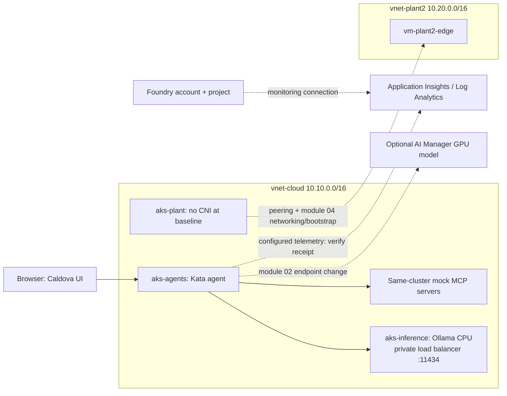

# Hands-on lab: Deploy and run Microsoft Foundry models and agents on AKS

A reproducible lab based on the Microsoft Ignite session **"Deploy and run Microsoft Foundry models and agents on AKS"** (Brendan Burns & Jorge Palma). It follows the session's story: **Caldova Pharmaceuticals**, a regulated manufacturer with 4 plants and 120 lines, wants an AI agent that cuts the time to troubleshoot production-line micro-stops. It has to run on the AKS infrastructure Caldova already has approved, under Caldova's control, across cloud and plant sites.

> `azd up` deploys the **infrastructure and CPU-based sample**. The modules then guide optional preview exercises (AI Manager, Flex nodes, Agent Sandbox, Agent Grid) and explain the access-gated Foundry own-AKS hosting boundary. A completed base deployment does not mean these previews are configured.

## Choose your learning track

| Track | Start here | What you will learn |
|---|---|---|
| **Portal-first / visual** | [Portal guide and capability matrix](docs/00-portal-guide.md) | Inspect resources, deploy/test an AI Manager model and configure Agent Grid visually; explicit terminal hand-offs for reproducible setup and host bootstrap. |
| **Code-first** | [01 – Prerequisites](docs/01-prerequisites.md), then modules 02–08 | Keep the PowerShell/Bash, Bicep and Kubernetes experience, with purpose, checkpoints and links to equivalent portal steps. |

Both tracks share **one deployment**, not separate environments. Learn the CPU agent/tool/model flow first, then change one layer at a time: model serving → hosting boundary → edge compute → isolation → network policy → evidence/cost. Preview exercises are optional and access-dependent. The Foundry own-AKS hosting path is an **access-gated discussion**, not a verified public walkthrough; the base is a plain FastAPI app on AKS.

Portal capabilities and preview requirements were checked against Microsoft documentation on **25 November 2026**; the [source register](docs/00-portal-guide.md#source-register) records the references. No live portal/deployment verification is implied.

## Architecture



For the actual baseline call paths and optional relationships, see the [visual learning path](docs/00-portal-guide.md#the-learning-path). The edge VM is not attached until module 04; the baseline uses the legacy Kata RuntimeClass, not the Kata v2 runtime required by the current Agent Sandbox guide.

## Session → lab map

| Session (approx.) | Topic | Module |
|---|---|---|
| 00:00–06:30 | Agents rewrite infrastructure; AKS as the AI foundation | – |
| 06:30–09:00 | AKS AI Manager: deploy open-weight Foundry models to AKS with one API | [02](docs/02-aks-ai-manager.md) |
| 09:00–12:30 | Caldova scenario, production-line app | `azd up` → agent UI |
| 12:30–15:00 | Foundry **AKS compute** preview: hosting boundary and access gates | [03](docs/03-foundry-aks-compute.md) |
| 15:00–19:00 | Heterogeneous, on-prem, multi-plant: **Flex nodes** | [04](docs/04-flex-nodes.md) |
| 20:00–24:00 | Sandboxing: **Kata** / **Agent Sandbox** | [05](docs/05-pod-sandboxing-agent-sandbox.md) |
| 24:00–30:00 | Policy and governed egress: **Agent Grid** | [06](docs/06-agent-grid.md) |
| 30:00+ | Observable, auditable, cost | [07](docs/07-observability-cost.md) |

## Quick start

```powershell
# see docs/01-prerequisites.md for tools, feature flags and preview sign-ups
azd auth login            # or: azd config set auth.useAzCliAuth true
azd env new ignite-aks
azd env set AZURE_LOCATION swedencentral
azd up                    # ~25 min: infra + images + Ollama + agent (postprovision hook)
azd env get-value AGENT_URL
```

After the `pull-models` job completes, open `AGENT_URL`, pick **line-7** and run **Guided** first, then **Autonomous** troubleshooting. The agent:
1. reads live signals and alarms via the **plant-signals** MCP server,
2. searches the equipment manual and maintenance history via the **maintenance** MCP server,
3. proposes a root cause, a restart procedure and a work order draft.

**Guided** runs a fixed tool plan; **Autonomous** lets the model choose the MCP tools via function calling. **Inspect** sends a camera frame to a vision model.

Models: `qwen2.5:1.5b` (chat) and `moondream` (vision) on CPU with Ollama, so no GPU quota is needed for the base. Duration varies; record your baseline. The 1.5B model is weak at multi-step tool calling in **Autonomous** mode (it often stops after one tool). Module 02 compares a GPU model after endpoint, authentication and rollout changes; it is not just a ConfigMap change.

**Checkpoint:** Guided returns analysis and tool timings; an assigned IP or `/healthz` alone does not prove model readiness. The demo is unauthenticated HTTP with fictional data, not a production endpoint. If governance-managed NSGs block the URL, do not bypass them: use the [approved-access troubleshooting path](docs/00-portal-guide.md#3-establish-the-cpu-application-baseline).

## Repo layout

| Path | Content |
|---|---|
| `infra/` | Bicep (azd): network, 3× AKS, edge VM, Foundry, ACR, monitoring, roles |
| `src/agent` | FastAPI agent + UI (OpenAI-compatible client, MCP client, OpenTelemetry) |
| `src/mcp-*` | Mock MCP servers (Streamable HTTP) with Caldova line data and manuals |
| `k8s/` | Ollama, agent (Kata runtime), MCP servers, network policy |
| `scripts/` | `deploy-apps.ps1` (postprovision), `new-flex-env.ps1` (module 04) |
| `docs/` | Portal-first guide 00 and code modules 01–08 |

## Disclaimer

Several features are **preview / limited preview**, change often and are not intended for production use. Check each module's current access, version, region and cost gates before executing commands. Caldova is fictional. Do not change governance controls to make a demo work. Clean up with [module 08](docs/08-cleanup.md).
