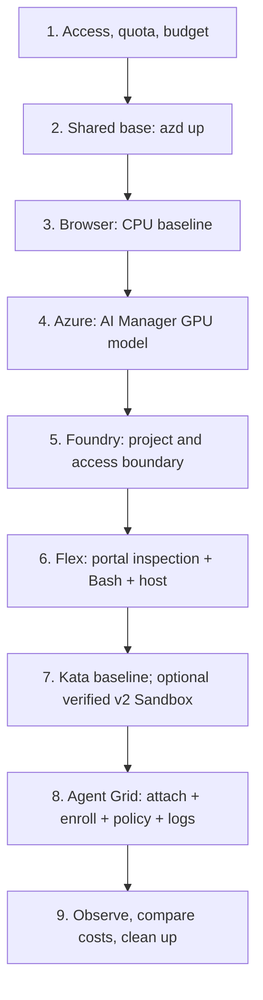
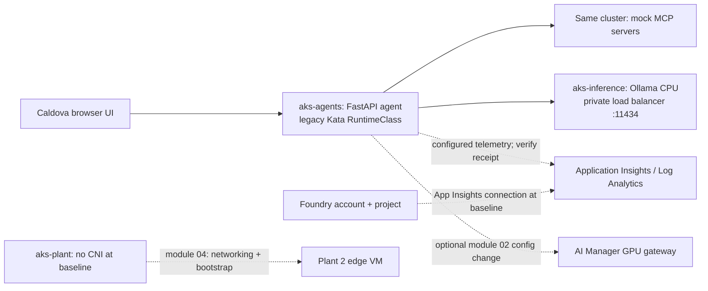

# Portal-first visual lab guide

[Home](../README.md) | [Code track: prerequisites](01-prerequisites.md)

Use the portals wherever there is a documented UI, with terminal hand-offs for the gaps. Both tracks use **the same environment**: do not deploy a second set of clusters.

**Documentation checked: 25 November 2026.** UI labels come from the Microsoft sources below, not a live tenant walkthrough. Preview availability, permissions, regions and labels can change. If a control is absent, check access and the current source; do not guess a replacement or weaken governance.

## Choose the right surface

| Surface | Meaning in this lab |
|---|---|
| **Azure portal**: [portal.azure.com](https://portal.azure.com) | Azure resources, Kubernetes center, AKS resource views, AI Manager, Agent Grid, monitoring, costs and deletion. |
| **Foundry portal**: [ai.azure.com](https://ai.azure.com) | Foundry project and AI development experience, not Azure's Kubernetes center. |
| **Application browser** | Caldova UI at `AGENT_URL`, or an approved local port-forward. Neither Azure nor Foundry portal. |
| **Cloud Shell**: [shell.azure.com](https://shell.azure.com) | A hosted **command line**, even inside Azure portal. Select PowerShell for PowerShell snippets; Bash for Flex articles. Files, installed extensions and network access differ from your workstation. |
| **Local terminal / WSL / host shell** | PowerShell 7 runs this repo's scripts. Linux-compatible Bash runs Flex commands; bootstrap executes on the edge Linux host. |

### What can be done without commands?

"Terminal hand-off" means required by **this reproducible lab**, not proof that no ARM/API/other UI alternative exists.

| Task | Portal/browser path | Terminal hand-off / limitation |
|---|---|---|
| Preview/provider registration, quota review | Azure subscription **Preview features**, **Resource providers**, **Usage + quotas** | Features not exposed in UI need CLI/PowerShell. Pending approval is not fixed by changing tools. |
| Exact base infrastructure, image builds and app deployment | Inspect resource group, deployments, ACR and AKS in Azure | Keep `azd up` and hooks for Bicep settings, dependencies, substitutions and ACR builds. No one-click equivalent is supplied here. |
| View/edit Kubernetes objects | AKS **Kubernetes resources**, configuration/custom resources, **Create > Apply a YAML** | YAML is still code. Substitute repo placeholders before applying. Kubernetes access and API reachability required. |
| Catalog, AI Manager, GPU model deployment | Azure **Kubernetes center > AI workloads > AI/ML**, including existing-cluster selection | Preview, regional catalog, license and GPU quota gates. CLI is an alternative, not mandatory. |
| Model status, test, scale, delete | Azure AI/ML **Deployments**, **Check status**, **Test model**, **Developer playground** | Playground settings are temporary. Connecting Caldova needs config/secret changes and restart. |
| Foundry project inspection | Foundry portal, existing project | Own-AKS hosted-agent onboarding is access-gated/unverified here; use approved preview instructions. |
| Flex networking, pool and host attachment | Inspect VM, identity, peering and AKS nodes; IAM supports role assignment | Current workflow requires Bash/plugin setup, Kubernetes configuration, bootstrap data and **host-side bootstrap**. No verified end-to-end point-and-click path. |
| Kata / Agent Sandbox | Inspect pool/workload YAML; apply Sandbox YAML after setup | Kernel checks require execution. Follow CLI extension/runtime setup; no verified complete portal wizard. |
| Agent Grid | Azure portal create, attach, enroll, policies, diagnostics and flow visualization | Limited-preview access and compatible cluster required; traffic tests run inside an enrolled workload. |
| Telemetry, cost, stop and deletion | Azure App Insights, AKS monitoring, Cost Management and resource lifecycle controls | Data must actually be collected. Stopping leaves billable items. |

## The learning path



Stages 4-8 are optional extensions of the CPU baseline. No GPU or preview approval? Keep the CPU app and do the read-only inspections. Never describe a skipped exercise as deployed.



Solid arrows are baseline app calls; dotted arrows are optional setup or telemetry relationships, not proof of working integrations. Module 04 does **not** automatically rewire the cloud agent to call the edge MCP pod.

## 1. Prepare access, region and budget

**Purpose:** avoid paying for a partial environment while waiting for permission. **Before:** [code module 01](01-prerequisites.md), including tools and roles.

1. In Azure portal, open **Subscriptions**, select the intended subscription and record its ID. Use it in every terminal and portal tab.
2. Select **Settings > Preview features**. Search the module's feature names and register the previews you plan to use. Wait for **Registered**. Missing feature? Use module 01's CLI path: only features whose services opt into this UI appear.
3. Under **Resource providers**, check/register module 01's providers after feature registration. Only an authorized operator should do this.
4. Open **Usage + quotas**, filter to the target region and VM families. Default Bicep requests 26 CPU vCPUs across six VMs; GPU capacity is additional. Verify regional availability instead of assuming `swedencentral` supports every preview.
5. Review a budget with your subscription owner in Cost Management. GPU replicas, sandbox/warm-pool capacity, disks, IPs, logs and preview dependencies can add charges. Budget alerts are **not** spending caps.

**Expected / verify:** correct subscription, registered flags/providers, quota and preview approvals recorded. Foundry own-AKS and Agent Grid access are separate gates, not granted by deploying the base.

**If blocked:** ask the subscription/preview owner; do not replace an approved network design. Continue with the CPU baseline only when its prerequisites are met.

## 2. Deploy once, then inspect visually

**Purpose:** connect declarative code to Azure resources. **Before:** stage 1 and [module 01 deployment steps](01-prerequisites.md#deploy-the-base-environment).

1. In **local PowerShell 7 at the repo root**, run module 01's `azd` sequence. This intentional terminal hand-off prepares SSH inputs, deploys Bicep, builds images in ACR and applies rendered Kubernetes YAML. Do not separately create clusters with a portal wizard.
2. Record `AZURE_RESOURCE_GROUP` and nonsecret cluster/account names from azd. Avoid sharing `azd env get-values`: it includes connection information.
3. In Azure portal, open that resource group and **Deployments**. Inspect deployment operations to locate any failed resource instead of repeatedly rerunning everything.
4. On `aks-inference-*` and `aks-agents-*`, open **Kubernetes resources > Workloads**. Select namespace `models` on inference and `caldova` on agents. Check Ollama and MCP/agent deployments; inspect pod events for scheduling/image errors.
5. Check inference's `pull-models` job: both chat and vision downloads must complete. Inspect the agent YAML for `runtimeClassName: kata-vm-isolation`. An assigned service IP or healthy `/healthz` alone does not prove inference.
6. Expect `aks-plant-*`'s managed node to be **NotReady** until Flex networking in stage 6: the base has no CNI there. Do not change inference/agents networking to match it.

**Expected / verify:** two clusters host the sample; the third deliberately awaits networking. [Microsoft's resource-view guide](https://learn.microsoft.com/azure/aks/kubernetes-portal) explains **Configuration**, **Network policies**, **Custom resources** and **Create > Apply a YAML**.

**If blocked:** Azure resource read permission is not Kubernetes data-plane permission. Check Kubernetes authorization and API reachability; a private cluster requires an approved network path. **Run command** is remote command execution, not a no-code or permission bypass.

## 3. Establish the CPU application baseline

**Purpose:** understand agent/tool/model calls before replacing components. **Before:** stage 2's downloads and workloads are ready.

1. Get `AGENT_URL` with `azd env get-value AGENT_URL`, or inspect the agent Service in **Services and ingresses** on `aks-agents-*`.
2. Open it through an approved path. The demo exposes HTTP without app authentication; use synthetic Caldova data only, not production plant data or credentials.
3. Select **line-7** and run **Guided**. Read the tool calls/timings alongside the analysis: signals identify equipment; manual, history and spares inform the recommendation.
4. Run **Autonomous**, comparing tools and completeness. The small CPU model may stop early: a quality observation, not proof Kubernetes is broken. **Inspect** uses the separate `moondream` vision model.
5. Record baseline duration, model and outcome for GPU and [telemetry comparisons](#9-observe-cost-and-clean-up).

**Expected / verify:** Guided returns evidence-backed output and tool timings. These UI timings are application JSON, not proof of distributed tracing.

**Public URL timeout:** inspect service endpoints, readiness and effective network rules with the platform owner. Governance-managed NSGs can block the public demo despite an assigned IP. Do **not** remove/override governance. Where permitted, use an approved workstation with Kubernetes API access:

```powershell
kubectl --kubeconfig .kube/agents -n caldova port-forward service/caldova-agent 8080:80 --address 127.0.0.1
```

Keep the terminal open, browse `http://127.0.0.1:8080`, then Ctrl+C to stop. This requires authorized Kubernetes access and organizational permission. Cloud Shell's localhost is not your workstation's localhost.

## 4. Deploy and test a GPU model in Azure portal

**Purpose:** replace CPU serving while retaining agent/tools. **Before:** [module 02](02-aks-ai-manager.md), AI Manager access, supported catalog/region, GPU quota and cost approval. Skip deployment if these gates fail.

1. Follow the **Azure portal** tab of the [AI Manager quickstart](https://learn.microsoft.com/azure/aks/ai-manager/quickstart): **Kubernetes center > AI workloads > AI/ML**. Review a model card's license/capabilities before **Deploy**.
2. Under **Project details**, select the lab subscription, resource group and region. Under **Deployment profile**, use the intended AI Manager or create one using the lab's **existing inference cluster**, not a new managed cluster. Verify its identity before submitting.
3. Use **Select SKU** to compare feasible GPU plans, quota and estimated performance. This is VM cost per replica, not total lab cost. Use module 02's namespace/deployment names when switching tracks.
4. In **AI/ML > Deployments**, wait for `Succeeded`, then **Check status** for inference readiness. **Overview** shows endpoint, GPU size, nodes and events.
5. Select **Test model** to open **Developer playground**. Ask a small question first. Playground parameter changes are temporary; the Caldova app has not changed.
6. **Overview > Authentication** exposes namespace credentials privately; **Get started** has request samples. Keep keys out of screenshots, Git and chat.
7. Complete [module 02's config/secret/restart hand-off](02-aks-ai-manager.md#point-the-agent-at-the-ai-manager-gateway). An authorized Kubernetes editor can alternatively update ConfigMap, Secret and Deployment through the portal YAML experience. Preserve Ollama vision settings: a chat deployment is not a vision model.
8. Rerun Guided/Autonomous and compare the actual model and result. [Manage deployments](https://learn.microsoft.com/azure/aks/ai-manager/manage-deployments) documents **Scaling method > Change** and deployment-only deletion.

**Expected / verify:** playground inference succeeds **and**, after the hand-off, Caldova uses the new model. Separate acceptance checks.

**If blocked:** distinguish preview/RBAC, GPU quota, regional capacity, provisioning and app network/authentication errors. AI Manager is **not** the separate KAITO AI toolchain operator; do not install KAITO as a substitute.

## 5. Inspect Foundry and the own-AKS access boundary

**Purpose:** distinguish project management from where code runs. **Before:** stages 2-3 and [module 03](03-foundry-aks-compute.md).

1. Locate `aif-caldova-*` in Azure portal. In [Foundry portal](https://ai.azure.com), select its existing `caldova-line-troubleshooting` project in the same tenant/subscription.
2. Compare with `infra/modules/foundry.bicep`: account, project identity and App Insights connection are created. No hosted agent or AKS hosting connection is created.
3. With own-AKS approval, obtain current onboarding instructions from the preview owner. Verify region, cluster, identities, image protocol and target before proceeding. The historical [registration link](https://aka.ms/byoaks-foundry-registration) is an access lead, not a verified walkthrough.
4. Otherwise, use the existing Caldova browser app and stage 9's telemetry inspection. Mark this stage **inspection only**.

**Expected / verify:** a monitoring connection does not register a FastAPI Deployment as a hosted agent. A real hosting exercise must show a created agent version and successful invocation on its intended target.

**Limitation:** current public [hosted-agent docs](https://learn.microsoft.com/azure/foundry/agents/concepts/hosted-agents) describe Microsoft-managed hosting/protocols; they do not substantiate the former lab's own-AKS menu sequence. Do not substitute managed hosting and claim the agent moved to your cluster.

## 6. Bring in the plant host: visual inspection plus Bash

**Purpose:** separate connected networks, a logical pool and a joined host. **Before:** base, approved Flex access and [module 04's address plan](04-flex-nodes.md).

1. Inspect `vnet-cloud` / `vnet-plant2` peering, `vm-plant2-edge`, its NIC IP forwarding, subnet and identity `id-vm-plant2-edge`. Peering simulates site connectivity; it does not install pod networking or join the VM.
2. Switch to module 04's **Linux-compatible Bash** sequence: environment/kubeconfig, Unbounded-Net, Sites, SitePeering, component/node checks, then Flex pool. Target only `aks-plant-*`.
3. Inspect the pool where the portal exposes it. Assign the host identity role through **Access control (IAM)** at the **pool resource scope** if available, or use module 04's CLI command. Do not broaden scope for convenience.
4. Complete host checks, download/checksum verification, short-lived bootstrap data transfer and **bootstrap on the Linux host**. Cloud Shell or a portal resource listing cannot replace this host action.
5. Return to AKS node/workload views. Complete module 04's node/machine checks and MCP workload/log check: the pod must actually be on the edge node.

**Expected / verify:** managed node Ready after CNI; edge node Ready after bootstrap; MCP pod placed on the edge node. Pool `Succeeded` alone is not attachment.

**If blocked:** compare CIDRs, SitePeering, daemon RBAC, identity scope/propagation, bootstrap expiry and connectivity against the [networking guide](https://learn.microsoft.com/azure/aks/configure-flex-nodes-networking). Ask the governance owner about denied paths rather than changing NSGs. An edge MCP pod does not redirect the cloud app's MCP URL; that is a separate reviewed exercise.

## 7. Inspect Kata, then decide on Agent Sandbox

**Purpose:** separate kernel isolation from a per-session sandbox lifecycle. **Before:** [module 05](05-pod-sandboxing-agent-sandbox.md).

1. Inspect agents' `kata` pool and Deployment YAML: the workload requests **`kata-vm-isolation`**, not `kata-vm-isolation-v2`.
2. Run module 05's runtime/node/kernel checks. A pool's `KataVmIsolation` property alone does not prove v2.
3. Stop the optional Sandbox **Kata** path until [current prerequisites](https://learn.microsoft.com/azure/aks/agent-sandbox-cluster-extension) are met: Kubernetes 1.35+, supported regional release, v2 handler `kata-v2`, all target nodes with genuine v2 capability labels and sufficient capacity. Do not manually label old nodes to fake capability.
4. Follow module 05 and official CLI setup. After controller/CRD checks, portal **Custom resources** can inspect Sandboxes and **Apply a YAML** can submit the current example. This does not convert the running app.

**Expected / verify:** baseline Kata evidence, or an optional ready Sandbox on verified v2 nodes. The current agent does **not** create SandboxClaims per troubleshooting request. Extra nodes and warm pools cost money.

**If blocked:** preserve the legacy pool; skip until the owner approves compatible capacity. Runtime migration is not part of this documentation change.

## 8. Configure Agent Grid visually

**Purpose:** add identity/tool-aware policy to compute isolation and baseline NetworkPolicy. **Before:** [module 06](06-agent-grid.md), limited-preview approval and [current limitations](https://learn.microsoft.com/azure/agent-grid/overview#limitations). The repo does not configure Entra-integrated AKS; docs say clusters should use it. Resolve eligibility with the cluster owner before enrollment.

1. Follow the [portal configuration guide](https://learn.microsoft.com/azure/agent-grid/configure-agent-grid). Search **AgentGrid**, choose **Create**, same subscription/region as `aks-agents-*`. Check preview registrations, including `Microsoft.NetworkSecurity/AgentGridPreview` and AKS `Microsoft.ContainerService/EnableAgentFabricPreview`.
2. **Grid members > Attached resources > Add**: choose **AKS cluster**, verified agents cluster, **Attach**. Wait for **Added to grid**. **Attachment alone changes no traffic.**
3. **Grid members > Members**: find Caldova in `caldova`, **Enroll** only the intended test workload. Confirm **Enrolled** and SPIFFE ID. If workloads cannot be read, use the documented namespace-read option and resolve permissions.
4. **Policies > Add policy**: select/create a lab-specific group, select the exact member identity and intended rules. Groups run from lowest priority number, policies top to bottom; first applicable decision wins. Review **Member connectivity**.
5. Preserve DNS, model, MCP and telemetry paths. Applicable FQDN/URL/MCP policies can deny other traffic unless allowed elsewhere. Derive destinations from actual configuration/flows, not a generic wildcard list. Do not edit shared governance groups.
6. Optional content inspection needs your own connected Azure AI Content Safety resource/key, appropriate TLS inspection for HTTPS and cost approval. Current docs describe Prompt Shields on JSON **request** bodies (POST/PUT/PATCH), not blanket screening of every tool response.
7. **Monitoring > Diagnostic settings > Add diagnostic setting**: select **AgentFabricFlowLogs**, send to the lab Log Analytics workspace, save.
8. Generate allowed and denied test traffic from the **enrolled workload** using module 06. In **Live inspect**, correlate source, destination, verdict and deciding rule; allow ingestion delay. **Flow map** visualizes the denied path.

**Expected / verify:** one allowed and one deliberately denied request attributable to the intended Grid rule. Browser failure, an NSG timeout or existing NetworkPolicy deny is not Grid proof.

**If blocked:** check eligibility, enrollment, identity, order, diagnostics and upstream rules. Private AKS is unsupported in this preview. For BYO networks, have the owner review gateway LB destination ports 15008/15009; do not add arbitrary inbound rules or bypass managed NSGs. Keep baseline NetworkPolicy.

## 9. Observe, cost and clean up

**Purpose:** connect browser outcomes to evidence and cost. **Before:** [module 07](07-observability-cost.md); retain an inventory of optional resources.

1. Run Guided and record time. Open Azure `appi-*` > **Transaction search** for the relevant time window and `caldova-agent`. Allow ingestion delay. Compare telemetry that actually arrives with the browser's tool-call list.
2. Shipped requirements omit OpenAI instrumentation after an incompatibility. Do not promise `gen_ai` spans, prompts, token counts or a full Foundry trace tree. An App Insights connection alone proves none of those; see module 07.
3. On inference/agents clusters, inspect **Monitoring > Insights** and workload events. Container insights is configured there, **not** on plant. Grid flow logs separately prove policy decisions.
4. In **Cost Management > Cost analysis**, select subscription/resource scope, time range and group by resource/service. Include AKS-managed resource groups, storage, IPs, GPU/model capacity and monitoring. The lab group may omit related charges; AI Manager's VM estimate is not a full bill.
5. For a pause, use AKS **Stop** and VM **Stop** where supported; confirm VM **Stopped (deallocated)**. Disks, IPs, registries and logs may still charge. Check AI Manager-owned compute separately. Recheck Flex and workload health after restarting.
6. For teardown, follow [module 08](08-cleanup.md): remove optional workloads/hosting connections, unenroll/detach Grid, delete unused Grid/policy resources, then remove AI Manager after reviewing its deletion summary. Delete the dedicated resource group in portal **or** use documented `azd down`, not both concurrently.
7. Verify deletion in Azure, inspect any lock/policy failure instead of removing controls, check retained/soft-deleted items, and later review residual costs.

**Expected / verify:** evidence supports only features actually exercised; no unintended chargeable resources remain. Portal deletion does not clean local azd state, kubeconfigs, downloads or SSH keys, nor purge every soft-deleted service.

## Source register

Authoritative capability references, including official screenshots where available:

| Topic | Microsoft documentation |
|---|---|
| Feature registration and UI visibility | [Preview features](https://learn.microsoft.com/azure/azure-resource-manager/management/preview-features) |
| Kubernetes views, YAML and access | [Kubernetes resources in Azure portal](https://learn.microsoft.com/azure/aks/kubernetes-portal) |
| AI Manager catalog, BYO cluster, SKU, playground, keys | [Quickstart (Azure portal tab)](https://learn.microsoft.com/azure/aks/ai-manager/quickstart) |
| Scaling/status/deployment-only deletion | [Manage deployments](https://learn.microsoft.com/azure/aks/ai-manager/manage-deployments) |
| Existing-cluster CLI | [az aimanager](https://learn.microsoft.com/cli/azure/aimanager) |
| App endpoint/authentication and role scopes | [Connect to endpoint](https://learn.microsoft.com/azure/aks/ai-manager/connect-to-endpoint), [Grant access](https://learn.microsoft.com/azure/aks/ai-manager/grant-access) |
| Hosted-agent protocol/hosting boundary | [Hosted agents](https://learn.microsoft.com/azure/foundry/agents/concepts/hosted-agents) |
| Flex command chain | [Networking/pool](https://learn.microsoft.com/azure/aks/configure-flex-nodes-networking), [Host/identity](https://learn.microsoft.com/azure/aks/prepare-flex-node-host-identity), [Attach](https://learn.microsoft.com/azure/aks/attach-flex-node-to-aks) |
| Sandbox runtime/version checks and manifests | [Agent Sandbox extension (Kata tab)](https://learn.microsoft.com/azure/aks/agent-sandbox-cluster-extension) |
| Grid access/regions/limits | [Overview](https://learn.microsoft.com/azure/agent-grid/overview) |
| Grid portal controls/order/logs/cleanup | [Configure Agent Grid](https://learn.microsoft.com/azure/agent-grid/configure-agent-grid) |

No screenshots are fabricated. Diagrams describe this repo; Learn screenshots illustrate the service UI and may differ from your tenant.
