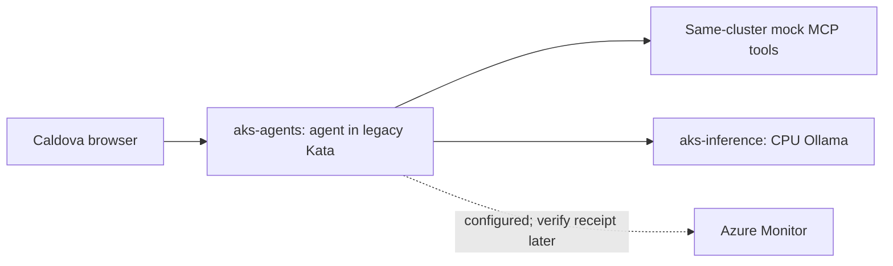

# 01 - Access, setup and the CPU baseline

[Portal experience](README.md) | [Next: models](02-aks-ai-manager.md)

**Learn:** connect the Azure resources to a working agent/tool/model flow before replacing any layer. You will deploy once, inspect the result visually and record a baseline for later comparisons.

**Before:** an approved disposable lab subscription/resource group, synthetic data only, and budget for the base resources. You need permission to deploy resources and create role assignments, plus Kubernetes data-plane access. Contributor alone does not grant role-assignment administration. Preview features can require separate approval.

**Surfaces:** Azure portal for access/inspection; local PowerShell 7 for the reproducible deployment; your browser for Caldova. No other documentation track is required.

## 1. Prepare subscription access and previews

1. Sign in to [Azure portal](https://portal.azure.com), open **Subscriptions**, select the intended subscription and record its ID. Check the directory/tenant too.
2. Open **Access control (IAM)** and have the subscription owner verify your permissions. For example, Owner or Contributor plus Role Based Access Control Administrator at the necessary scope can cover deployment/role assignments. Kubernetes authorization is a separate check.
3. Open **Settings > Preview features**. Register only the features needed for the exercises you intend to run:

   | Exercise | `Microsoft.ContainerService` feature names |
   |---|---|
   | Baseline legacy Kata pool | `KataVMIsolationPreview` |
   | Optional AI Manager | `AIManagerPreview` |
   | Optional Flex | `AKSFlexNodePreview`, `PutMachinePreview` |
   | Optional Kata v2 / Sandbox | `KataVMIsolationV2Preview`, `AgentSandboxPreview` |

4. Wait for **Registered**. Pending access is not fixed by changing tools.
5. Under **Resource providers**, check/register `Microsoft.ContainerService`, `Microsoft.KubernetesConfiguration` and `Microsoft.CognitiveServices` as applicable. Refresh provider registration after feature registration.
6. Foundry own-AKS hosting and Agent Grid have separate access gates. The [historical own-AKS registration](https://aka.ms/byoaks-foundry-registration) is an access lead, not a deployment contract. Agent Grid also requires `Microsoft.NetworkSecurity/AgentGridPreview`, its provider and `Microsoft.ContainerService/EnableAgentFabricPreview`; module 06 handles eligibility. Neither preview is required for the CPU app.

Some flags are not exposed in the portal. **Terminal fallback, local PowerShell**, only with subscription-owner approval:

```powershell
az login
az account set --subscription '<subscription-id>'
$flags = 'AIManagerPreview','AKSFlexNodePreview','PutMachinePreview','KataVMIsolationPreview','KataVMIsolationV2Preview','AgentSandboxPreview'
# Remove optional features you will not use before running this full-lab example.
foreach ($flag in $flags) {
  az feature register --namespace Microsoft.ContainerService --name $flag -o none
}
foreach ($flag in $flags) {
  az feature show --namespace Microsoft.ContainerService --name $flag --query "{name:name,state:properties.state}" -o table
}
```

Only when the selected features are Registered, refresh the providers:

```powershell
az provider register -n Microsoft.ContainerService
az provider register -n Microsoft.KubernetesConfiguration
az provider register -n Microsoft.CognitiveServices
```

**Checkpoint:** intended subscription/tenant, effective roles, registered features/providers and outstanding approvals recorded. A registered feature does not prove that an existing node has a newer runtime.

## 2. Review region, quota and cost

1. In **Usage + quotas**, filter to the base region, `swedencentral` by default, and the DSv5 family. Check both family and total regional quota.
2. The default Bicep requests **26 CPU vCPUs across six VMs**: inference D4 + D8, agents D4 + D4, plant D2, edge D4. There is **no GPU requirement for the base**.
3. Verify regional VM/preview availability. Agent Grid must share a supported region with its attached agents cluster. Do not assume every optional feature is available wherever ordinary AKS is offered.
4. In **Cost Management**, review the planned resources and set appropriate budget alerts with the owner. Alerts are **not spending caps**. Nodes, disks, load balancers, public IPs, ACR and logs cost money even without GPU models.
5. For a separate Malaysia West GPU exercise, keep the base region unchanged. Module 02 explains the separate group/cluster, quota, cost and connectivity checks; do not relocate the whole lab by changing one environment variable.

**Checkpoint:** baseline cost approved and enough regional/family quota available. Quota is permission to allocate, not guaranteed capacity.

## 3. Deploy or resume the base

There is no one-click portal package for this repository's exact infrastructure, image builds and rendered manifests. Use this terminal step once, then return to the portal. Do not create additional portal clusters alongside it.

Install/check these tools on your workstation:

| Tool | Requirement |
|---|---|
| PowerShell | 7; required by the deployment scripts, including on Linux |
| Azure CLI | 2.80+ for the original base; module 05 requires 2.85.0+ for its optional exercise |
| Azure Developer CLI | azd 1.20+ |
| kubectl | Compatible with the target cluster; within one minor version for current Flex steps |
| `aks-preview` extension | 22.0.0b8 or later; verify current preview prerequisites before optional exercises |

No local Docker is needed; image builds run in ACR. Clone/open this repo and run **local PowerShell 7 from its root**, not from `docs/portal`.

**Existing lab?** Run `azd env list`, select it with `azd env select <existing-name>`, confirm its subscription/resource group, and resume section 4. Do not run `azd env new` or `azd up` merely to change documentation experiences.

**New lab only:**

```powershell
az login
az account set --subscription '<subscription-id>'
az extension add -n aks-preview --upgrade
azd auth login
azd env new ignite-aks
azd env set AZURE_LOCATION swedencentral
azd up
```

In the azd prompts select the same subscription and approved region. The preprovision hook creates the dedicated `~/.ssh/ignite_lab` key and attempts to restrict edge SSH to your public IP. Verify the approved source; if IP detection fails, stop and resolve it rather than accepting unrestricted SSH. The postprovision hook builds images in ACR and deploys Ollama, the mock MCP tools and the agent.

After deployment, retrieve only nonsecret identifiers:

```powershell
azd env get-value AZURE_RESOURCE_GROUP
azd env get-value AKS_INFERENCE_NAME
azd env get-value AKS_AGENTS_NAME
azd env get-value AKS_PLANT_NAME
azd env get-value FOUNDRY_ACCOUNT_NAME
azd env get-value FOUNDRY_PROJECT_NAME
azd env get-value AGENT_URL
```

Avoid sharing `azd env get-values`, kubeconfig contents or connection strings. If provisioning fails, inspect the failed deployment operation and resolve its cause before retrying.

## 4. Inspect the result in Azure portal

1. Open the recorded resource group and **Deployments**. Check provisioning results and inspect any failed operation.
2. Open `aks-inference-*` > **Kubernetes resources > Workloads**. Select namespace `models`. Inspect Ollama and the `pull-models` job; both chat and vision downloads must finish.
3. Open `aks-agents-*` > **Kubernetes resources > Workloads**, namespace `caldova`. Inspect `caldova-agent`, `mcp-plant-signals` and `mcp-maintenance`. Check pod readiness/events, not just deployment existence.
4. Inspect the agent Deployment YAML. It requests `runtimeClassName: kata-vm-isolation` and the `sandbox: kata` pool.
5. Expect the plant cluster's managed node to be **NotReady** until module 04 installs its CNI. Inference and agents should be Ready; do not copy the plant's networking settings to them.
6. In **Services and ingresses**, inspect `caldova-agent` and its external endpoint. An assigned IP or healthy `/healthz` is not proof that models are ready.

If Kubernetes views cannot load, check Kubernetes authorization and API reachability. Azure resource read permission alone is insufficient. A private endpoint needs an approved network path. **Run command** is command execution, not a permission bypass.

## 5. Establish the browser baseline



1. Open the recorded `AGENT_URL` through an approved path. This demo is unauthenticated HTTP: use fictional Caldova data only.
2. Select **line-7** and run **Guided**. Signals/alarms identify equipment; manuals, history and spares inform the recommendation. Read tool calls and timings alongside the analysis.
3. Run **Autonomous**. Its small `qwen2.5:1.5b` CPU model may stop after one tool; this is a model-quality limitation, not necessarily a Kubernetes fault.
4. Run **Inspect**. It uses the separate `moondream` vision model, which later chat-only changes must preserve.
5. Record UTC time, model, duration, tool calls and whether each mode completed. You will compare these observations after model/policy changes and in module 07.

**Expected:** Guided returns evidence-backed analysis and tool timings. UI timings are application JSON, not proof of exported distributed traces.

### Approved access when the public URL is blocked

Inspect Service endpoints, readiness, routes and effective NSGs with the platform owner. Governance-managed NSGs can block the public demo despite an assigned IP. Do **not** remove/override governance rules.

Where policy permits, an authorized workstation with Kubernetes API access can forward the app locally. Run in **local PowerShell at the repo root**; module 01's hooks create the kubeconfig:

```powershell
kubectl --kubeconfig .kube/agents -n caldova port-forward service/caldova-agent 8080:80 --address 127.0.0.1
```

Keep the terminal open, browse `http://127.0.0.1:8080`, and Ctrl+C when finished. Cloud Shell's localhost is not your workstation's localhost.

## Troubleshooting and carry forward

| Symptom | Check |
|---|---|
| Deployment or role assignment denied | Deployment operations, effective roles, approval and Azure Policy with the owner; do not remove policy. |
| Pending/image/model errors | Workload events, ACR pull permissions, quota and `pull-models` logs. |
| Admin credentials prohibited | Hooks use `--admin`; arrange approved Kubernetes access instead of enabling local accounts to bypass policy. |
| App available but Guided fails | Model downloads/readiness and agent/MCP logs; distinguish app, network and model errors. |
| Optional preview unavailable | Continue baseline inspections; do not describe an unexecuted preview as deployed. |

**Carry forward:** azd environment name, base subscription/region/group, cluster names, protected local kubeconfigs and baseline results. Keep a separate inventory of any optional resources. [Module 02](02-aks-ai-manager.md) changes only the model-serving layer; [module 08](08-cleanup.md) applies even after a partial setup.

**References:** [Preview feature UI](https://learn.microsoft.com/azure/azure-resource-manager/management/preview-features), [Kubernetes portal views](https://learn.microsoft.com/azure/aks/kubernetes-portal).
