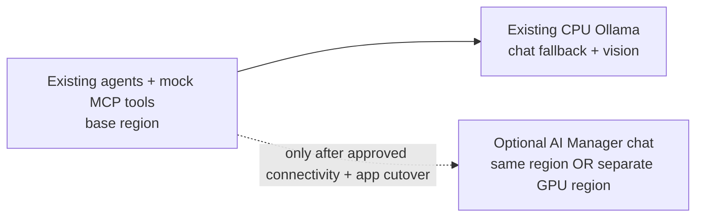

# 02 - Deploy a model with AI Manager

[Previous: baseline](01-prerequisites.md) | [Portal experience](README.md) | [Next: Foundry boundary](03-foundry-aks-compute.md)

**Learn:** replace CPU chat inference while retaining the browser agent, MCP tools and vision endpoint from module 01. First prove the model independently; only then change the application.

**Before:** a working CPU baseline, `AIManagerPreview` registered, approved GPU cost/quota, and access to the exact regional model/SKU. AI Manager is optional and is not the separate KAITO AI toolchain operator. Skip paid creation if these gates fail.

**Permissions:** AIManager Contributor manages deployments; Model User reads catalog/costs; Inference User retrieves namespace keys or invokes with Entra ID. Obtain appropriately scoped roles from an authorized administrator. Azure resource access and Kubernetes editing permissions are different.

**Surfaces:** Azure portal for the model lifecycle and Kubernetes editing; Caldova browser for the final comparison. All app-cutover steps are included below.

## 1. Choose the topology before creating anything

| Choice | Use when | Cluster and resource group |
|---|---|---|
| Reuse baseline inference | Exact model/SKU is available in the base region | Select the existing `aks-inference-*` cluster in the base group. It has RBAC, system-assigned identity and Cilium. |
| Separate GPU tier | GPU availability is in another region, such as Malaysia West | Use a **new dedicated GPU-test group** and a **new AI Manager-managed cluster** in that region. Keep the existing lab untouched. |

An existing cluster must be in the **same region as AI Manager**. Do not select a Swedish cluster for a Malaysia West model or change `AZURE_LOCATION` in the existing azd environment to relocate the lab.



A separate-region tier adds latency, traffic charges and connectivity work. It does not relocate Foundry or make Agent Grid available in a new region. A standalone playground test is a valid stopping point.

## 2. Select the model and review cost

1. In [Azure portal](https://portal.azure.com), open **Kubernetes center > AI workloads > AI/ML**.
2. Open a model card, read its license/capabilities and choose **Deploy**. `Qwen/Qwen3.5-4B` is one candidate to inspect, not a promise of availability or application quality.
3. Under **Project details**, select the correct subscription, intended group and region from section 1.
4. Under **Deployment profile**, select/create the intended AI Manager. For reuse, verify the existing inference cluster's name/region. For a separate GPU region, create new managed compute rather than selecting any baseline cluster.
5. Choose **Select SKU**. Inspect the exact model/SKU, quota, estimated performance, VM count per replica and maximum replicas. A T4 plan such as `Standard_NC4as_T4_v3` is usable only when your current form offers it as available. An A10 family name does not make all fractional sizes interchangeable.
6. Select **one fixed replica**, not autoscaling or multiple replicas, for this test. If the form assigns namespace/deployment names, record the actual names; `line-troubleshooting` and `qwen-chat` are examples, not mandatory portal defaults.
7. Review the final estimate and resource creation summary before submitting. Include system nodes, disks, load balancers, IPs, networking and monitoring, not just the GPU estimate.

For an existing shared cluster, verify the manager's cluster deletion policy is **Keep** before removing that manager later. If the portal does not expose this setting, do not assume its default preserves compute; use deployment-only deletion for the model or have the owner verify the policy.

**Cost/availability gate:** quota is not a reservation. There is no verified documented Spot selection in this workflow; **treat the deployment as regular capacity, not Spot-priced**. Do not silently substitute a larger SKU if the intended one is unavailable. If portal and CLI plans disagree, confirm the exact model/region and preview versions and retain the portal evidence; do not claim the discrepancy is resolved.

## 3. Deploy and prove inference

1. Submit only the reviewed plan. Open **AI/ML > Deployments** and wait for provisioning **Succeeded**.
2. Select **Check status** and verify one ready replica, the intended VM size and inference health. Inspect deployment events if it fails.
3. Select **Test model** to open **Developer playground**. Ask a small question first, for example "What does Kubernetes do?"
4. Confirm a meaningful response. Playground settings are temporary; success here does **not** change Caldova.
5. Open **Overview > Authentication** privately to locate the namespace endpoint and API key. **Get started** provides request samples. Do not share keys, save them in Git or include them in screenshots.
6. Record nonsecret resource IDs/names: subscription, group, region, manager, namespace, deployment and associated cluster/managed groups. The separate GPU deployment is **not tracked by the base azd environment**.

**Expected:** the independently deployed model serves a response. Do not connect Caldova until this checkpoint passes.

## 4. Check the network path before switching the app

The agents cluster's `agent-egress` NetworkPolicy permits the original private inference subnet on TCP 11434 and public IPv4 HTTPS. It does not automatically permit another private subnet, gateway port or cross-region route.

1. Identify the actual namespace endpoint hostname, scheme and port. Use the returned base URL **as supplied**; do not add another `/v1`.
2. Have the platform owner verify approved DNS, routes, exposure and effective NSG/firewall/NetworkPolicy rules from `aks-agents-*` to this endpoint.
3. For a separate private tier, arrange the approved connectivity design first; do not assume changing a ConfigMap creates connectivity.
4. If the path is not approved/working, leave Caldova on CPU and keep this as a standalone model test. Do not disable policies or expose inference broadly to make the demo work.

## 5. Connect Caldova using the Kubernetes editor

These are Kubernetes changes through Azure portal, **not an edit to the source files**. Kubernetes authorization and API reachability are required. Open **the existing agents cluster**, not the new GPU cluster.

### Preserve rollback and vision settings

1. Open **Kubernetes resources > Configuration**, namespace `caldova`, and inspect ConfigMap **`agent-config`**.
2. Record the original nonsecret `LLM_BASE_URL` and `LLM_MODEL`. If this is not the module 01 CPU baseline, stop and establish the correct rollback values first.
3. Retain the existing `VISION_MODEL: moondream`. Vision must continue using the **old CPU chat base URL**, not the new chat-only gateway.

### Create the API-key Secret

Use the cluster's **Create > Apply a YAML** experience to create this object, replacing the placeholder privately:

```yaml
apiVersion: v1
kind: Secret
metadata:
  name: llm-key
  namespace: caldova
type: Opaque
stringData:
  LLM_API_KEY: "<namespace-primary-key>"
```

Kubernetes Secrets are not a vault; base64 in the portal does not encrypt a key against authorized readers. Use an approved private editing session, never commit this filled-in YAML, and do not overwrite an existing shared Secret with this name.

### Update configuration and roll out

1. Edit `agent-config` YAML. Preserve its other fields, including all MCP URLs and telemetry configuration. Set:

   | Key under `data` | Value |
   |---|---|
   | `LLM_BASE_URL` | Exact namespace endpoint from AI Manager |
   | `LLM_MODEL` | Actual **model deployment name**, not catalog model ID |
   | `VISION_BASE_URL` | Recorded original CPU `LLM_BASE_URL` |
   | `VISION_API_KEY` | `not-needed` for the baseline Ollama |

2. Save the ConfigMap.
3. Open **Workloads**, select Deployment **`caldova-agent`**, and edit its YAML. Under `spec.template.spec.containers`, locate the container named `agent`. Preserve image, runtime, node selector, limits, probes and existing `envFrom`; add this `env` entry without duplicating any existing `LLM_API_KEY` entry:

   ```yaml
   env:
     - name: LLM_API_KEY
       valueFrom:
         secretKeyRef:
           name: llm-key
           key: LLM_API_KEY
   ```

4. Save the Deployment. A pod-template change creates a rollout; observe pod events and wait for a Ready replacement pod. ConfigMap changes alone do not update a running process's environment.
5. On later config-only edits, trigger a rollout by updating a pod-template annotation in the Deployment YAML, preserving other annotations:

   ```yaml
   # Under spec.template.metadata, alongside labels:
   annotations:
     lab.caldova/restarted-at: "<current-UTC-time>"
   ```

   Replace the placeholder with a new quoted UTC timestamp. Do not change only the Deployment's top-level metadata; that does not restart pods.

## 6. Verify the app and recover

1. Through module 01's approved app URL/port-forward, open `/api/config`. Confirm the chat endpoint and deployment name; do not expose secrets.
2. Run **Guided** on line-7, then **Autonomous**. Compare duration, tool selection and output with your CPU baseline; a GPU does not guarantee better tool use.
3. Run **Inspect** and confirm Ollama vision still works.
4. If only the playground works, distinguish app reachability, authentication and configuration errors. A Ready app pod alone does not prove its model calls succeed.

| Symptom | Check |
|---|---|
| Deployment unavailable | Exact model/region/SKU, preview registration, roles, quota versus actual capacity. |
| Chat 401/403 | Correct namespace key, authorization mode and Secret reference. |
| Chat timeout | Approved routes/DNS/port and effective NetworkPolicy/NSGs; do not remove governance. |
| Model not found | `LLM_MODEL` must be the actual deployment name. |
| Inspect stops working | Restore explicit CPU vision endpoint and original vision model. |
| Settings revert later | `scripts/deploy-apps.ps1` reapplies the baseline ConfigMap; review/reapply intentional overrides after a redeploy. |

**Rollback:** restore the recorded CPU `LLM_BASE_URL`/`LLM_MODEL` in the ConfigMap, remove only the `LLM_API_KEY` env entry added to the Deployment, and change the pod-template annotation to roll out. Verify Guided and Inspect again. Delete `llm-key` only when nothing references it. Do this before removing a model still used by the app.

**Carry forward:** actual topology/model/deployment name, baseline/GPU outcomes, rollback values and separate-resource inventory. Continue to [module 03](03-foundry-aks-compute.md) whether or not you completed this optional deployment. Use [module 08](08-cleanup.md) when the GPU test ends; leaving it idle can still incur charges.

**References:** [Portal quickstart](https://learn.microsoft.com/azure/aks/ai-manager/quickstart), [Cost estimates](https://learn.microsoft.com/azure/aks/ai-manager/estimate-cost), [Endpoints](https://learn.microsoft.com/azure/aks/ai-manager/connect-to-endpoint), [Roles](https://learn.microsoft.com/azure/aks/ai-manager/grant-access), [Manage/delete models](https://learn.microsoft.com/azure/aks/ai-manager/manage-deployments).
