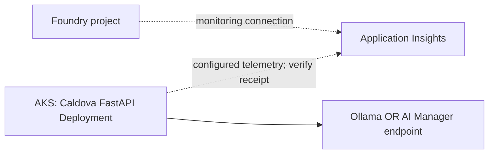

# 03 - Foundry project and the hosting boundary

[Previous: models](02-aks-ai-manager.md) | [Portal experience](README.md) | [Next: plant compute](04-flex-nodes.md)

**Learn:** a Foundry project, an inference endpoint, an AKS application and a Foundry hosted agent are different resources. Module 02 changes model serving; it does not register the application with Foundry.

**Before:** module 01's working baseline and project access. GPU deployment is optional. This module is **read-only inspection** unless you separately have own-AKS preview approval and current onboarding instructions.

**Surfaces:** Azure portal to locate resources, Foundry portal to inspect the project, and the Caldova browser to compare configuration.

## 1. Find the existing project

1. Open the baseline resource group in [Azure portal](https://portal.azure.com).
2. Locate the Foundry account `aif-caldova-*`. Record the actual account/subscription/region; a separate Malaysia GPU tier does not move it.
3. Open [Foundry portal](https://ai.azure.com) in the same directory. Select the existing account and **`caldova-line-troubleshooting`** project.
4. If it is missing, verify directory, subscription, project identity and access with the owner. Do not create a replacement project just to make a menu appear.

**Expected:** the project created by the base deployment is visible.

## 2. Inspect what was actually deployed

1. Inspect the project's monitoring connection. The base Bicep creates an Application Insights connection; it does not create a hosted agent or an own-AKS hosting connection.
2. Return to Azure portal > `aks-agents-*` > **Kubernetes resources > Workloads**, namespace `caldova`. Inspect Deployment `caldova-agent`, its container image and running pod.
3. Compare with the Caldova browser's `/api/config`: the endpoint points to Ollama, or to the AI Manager model you explicitly configured in module 02.
4. Explain the ownership boundary: Kubernetes manages the FastAPI Deployment; Ollama/AI Manager serves model requests; the Foundry project exists separately.

**Checkpoint:** project visibility and a monitoring connection do **not** prove hosted-agent registration, Content Safety enforcement or complete GenAI traces. Module 07 inspects the data that actually arrives.

## 3. Decide whether own-AKS hosting is available

The session demonstrated a preview own-AKS hosting experience. The [historical registration link](https://aka.ms/byoaks-foundry-registration) is an access lead, not a verified current deployment contract.

Current public [hosted-agent documentation](https://learn.microsoft.com/azure/foundry/agents/concepts/hosted-agents) describes Microsoft-managed hosting/protocols. It does not establish a working own-AKS menu path for this repo. Do not search indefinitely for the former guessed Compute clusters/AKS compute menus, silently deploy to managed hosting or use Azure Machine Learning AKS compute and call it the same exercise.

**Without current approval/instructions:** mark this module **inspection only** and continue to module 04. Nothing is broken in the CPU app.

**With approval:**

1. Obtain the preview owner's current onboarding instructions, supported region/cluster versions and identity/RBAC requirements.
2. Verify the intended hosting cluster, registry pull identity, image architecture, protocol and health routes. The repo's `/api/troubleshoot` FastAPI API is not automatically a supported Foundry agent protocol; an adapter would be a separate implementation task.
3. Confirm approved private MCP/model reachability, secret handling and incremental compute/logging/network costs. Inference attachment and agent hosting may be separate operations.
4. Follow those approved instructions; do not create another model deployment by accident or assume Kata placement is automatic.
5. Verify an agent version exists, invoke its real endpoint and locate the resulting workload on the intended AKS target. Preserve the baseline until those checks pass.

## Troubleshooting and carry forward

| Observation | Meaning / next step |
|---|---|
| Project exists but no registered agent | Expected baseline; inspect the AKS app independently. |
| Own-AKS control is missing | Check eligibility/current onboarding with the preview owner, not just portal labels. |
| Image fails to start | Verify the actual hosting protocol and image requirements. |
| Tracing view empty | No guarantee that the app exports compatible GenAI spans; inspect module 07's evidence. |

**Carry forward:** which service owns the model endpoint, which owns the app Deployment, and whether hosting was actually exercised or only inspected. [Module 04](04-flex-nodes.md) adds a different kind of compute: an edge host joined to the plant cluster. It does not depend on GPU or hosted-agent deployment.
