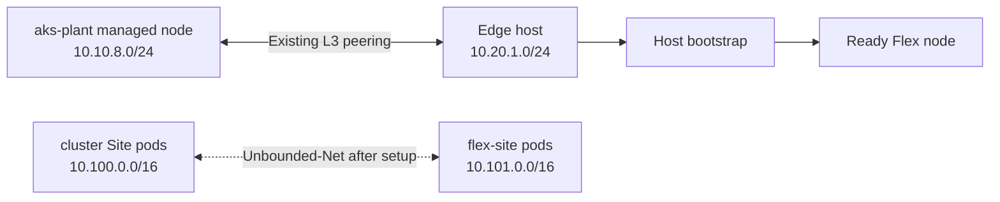

# 04 - Bring the plant host into AKS with Flex nodes

[Previous: hosting boundary](03-foundry-aks-compute.md) | [Portal experience](README.md) | [Next: isolation](05-pod-sandboxing-agent-sandbox.md)

**Learn:** peering connects networks, a CNI connects pods, a Flex pool describes external capacity, and bootstrap actually joins a host. You will inspect those boundaries in the portal, then prove a workload runs on the edge VM.

**Before:** module 01's base deployment, approved Flex access, permission to configure the **plant** cluster and assign a role at pool scope, and an approved SSH/network path. GPU and hosted-agent exercises are not prerequisites.

**Surfaces:** Azure portal for visual inspection and IAM; local PowerShell for the repo helper; Linux-compatible Bash/WSL for cluster preparation; an SSH session on the Linux VM for bootstrap. There is no verified end-to-end point-and-click path for this exercise. All required lab commands are included here.

## 1. Inspect the topology in Azure portal

1. In the baseline group, inspect `vnet-cloud` and `vnet-plant2` peering. It simulates site connectivity, not a joined Kubernetes node.
2. Open `vm-plant2-edge`: Ubuntu 24.04, four vCPUs. Inspect its NIC, private IP, IP forwarding and user-assigned identity **`id-vm-plant2-edge`**. Do not create another VM or identity.
3. Open `aks-plant-*`. Its base networking is `networkPlugin: none`; its managed node can be NotReady before CNI installation.
4. Do **not** install Unbounded-Net on inference or agents; they keep Azure CNI/Cilium.



| Range | Lab value |
|---|---|
| AKS node subnet / node CIDR | `10.10.8.0/24` |
| AKS pod CIDR | `10.100.0.0/16` |
| Flex host subnet / node CIDR | `10.20.1.0/24` |
| Flex pod CIDR | `10.101.0.0/16` |
| Service CIDR / DNS IP | `10.110.0.0/16` / `10.110.0.10` |

Use the approved effective routes/NSGs, not merely the Bicep definition. Governance may add controls. Ask the owner to resolve blocked paths; do not remove managed NSGs.

## 2. Prepare the terminal environment

Run **local PowerShell 7 from the repository root**, with the existing base azd environment selected:

```powershell
./scripts/new-flex-env.ps1
```

This writes `.flex/ignite-flex.env` with the lab's existing resource names, address plan and identity identifiers. It does not configure networking or join the host.

Use WSL Ubuntu on Windows with Azure CLI, `aks-preview`, compatible `kubectl`, `jq`, `curl`, `tar`, `sha256sum`, SSH and SCP installed. Copy the generated file and the dedicated lab keys into WSL, adjusting both paths below:

```bash
REPO=/mnt/c/path/to/ignite-aks-ai-foundry
WINDOWS_HOME=/mnt/c/Users/your-windows-user
install -D -m 0600 "$REPO/.flex/ignite-flex.env" ~/.config/aks-flexnode/ignite-flex.env
install -D -m 0600 "$WINDOWS_HOME/.ssh/ignite_lab" ~/.ssh/ignite_lab
install -D -m 0644 "$WINDOWS_HOME/.ssh/ignite_lab.pub" ~/.ssh/ignite_lab.pub

export FLEXNODE_DEPLOYMENT="ignite-flex"
export FLEXNODE_ENV_FILE="${HOME}/.config/aks-flexnode/${FLEXNODE_DEPLOYMENT}.env"
source "${FLEXNODE_ENV_FILE}"
umask 077
install -d -m 0700 "${WORK_DIR}"
az login
az account set --subscription "${SUBSCRIPTION_ID}"
az extension add -n aks-preview --upgrade
```

**Version gate:** the helper pins `AKS_PREVIEW_VERSION`, `UNBOUNDED_VERSION` and `AKS_FLEX_NODE_VERSION`; compare them and the actual installed versions with the current references at the end of this module. Confirm the region has AKS release **v20260904 or later** in the [release tracker](https://releases.aks.azure.com/AKSRelease). If an upgrade is required, obtain approval for the plant cluster, then regenerate the environment file; do not upgrade unrelated clusters.

Fetch a **dedicated plant kubeconfig** and confirm the targets:

```bash
export FLEXNODE_KUBECONFIG="${WORK_DIR}/kubeconfig"
az aks get-credentials -g "${RESOURCE_GROUP}" -n "${CLUSTER_NAME}" --admin \
  -f "${FLEXNODE_KUBECONFIG}" --overwrite-existing
chmod 0600 "${FLEXNODE_KUBECONFIG}"
set_flexnode_env FLEXNODE_KUBECONFIG "${FLEXNODE_KUBECONFIG}"
export KUBECONFIG="${FLEXNODE_KUBECONFIG}"
az aks show -g "${RESOURCE_GROUP}" -n "${CLUSTER_NAME}" \
  --query "{id:id,api:(privateFqdn || fqdn),version:currentKubernetesVersion}" -o table
kubectl cluster-info
kubectl get nodes
ssh -i "${SSH_PRIVATE_KEY_PATH}" "${FLEX_HOST_SSH_TARGET}" hostname
```

Stop unless the resource ID matches `AKS_RESOURCE_ID`, Kubernetes targets that cluster, and SSH reaches `vm-plant2-edge`. If admin credentials or SSH are prohibited, arrange an approved access path; do not bypass the restriction.

## 3. Install pod networking and connect the Sites

Run in the **same Bash session**, targeting only the plant cluster. This example uses the lab's AMD64 WSL environment:

```bash
test "$(uname -m)" = x86_64
DOWNLOAD_DIR="${WORK_DIR}/unbounded-cli"
install -d -m 0700 "${DOWNLOAD_DIR}"
curl -fLsS --proto '=https' --tlsv1.2 \
  "https://github.com/Azure/unbounded/releases/download/${UNBOUNDED_VERSION}/kubectl-unbounded-linux-amd64.tar.gz" \
  -o "${DOWNLOAD_DIR}/unbounded.tar.gz"
tar -xzf "${DOWNLOAD_DIR}/unbounded.tar.gz" -C "${DOWNLOAD_DIR}"
sudo install -m 0755 "${DOWNLOAD_DIR}/kubectl-unbounded" /usr/local/bin/kubectl-unbounded
kubectl unbounded version
```

Stop on download/extraction/version errors. Install the CNI and define the two Sites:

```bash
kubectl unbounded install --timeout 5m
kubectl unbounded site init --name flex-site \
  --cluster-node-cidr "${AKS_NODE_CIDR}" --cluster-pod-cidr "${AKS_POD_CIDR}" \
  --node-cidr "${FLEX_NODE_CIDR}" --pod-cidr "${FLEX_POD_CIDR}"
kubectl apply -f - <<'EOF'
apiVersion: net.unbounded-cloud.io/v1alpha1
kind: SitePeering
metadata:
  name: cluster-flex-private-l3
spec:
  sites: [cluster, flex-site]
  meshNodes: true
  tunnelProtocol: Auto
EOF
kubectl -n unbounded-system wait --for=create deployment/unbounded-net-controller --timeout=5m
kubectl -n unbounded-system wait --for=create daemonset/unbounded-net-node --timeout=5m
kubectl -n unbounded-system rollout status deployment/unbounded-net-controller --timeout=5m
kubectl -n unbounded-system rollout status daemonset/unbounded-net-node --timeout=5m
kubectl wait --for=condition=Ready nodes --all --timeout=5m
kubectl get nodes -L net.unbounded-cloud.io/site -o wide
kubectl get sites,sitepeerings -o wide
```

**Checkpoint:** managed nodes are Ready and assigned to `cluster`; both Sites exist; the peering connects them with mesh enabled; `flex-site` has no hosts yet.

Check whether the temporary preview daemon permissions already exist:

```bash
kubectl get clusterrole aks-flex-node-daemon
kubectl get clusterrolebinding aks-flex-node-daemon
```

If either reports **NotFound** (not an authorization/network error), apply the following. Preserve existing resources if both are present:

```bash
kubectl apply -f - <<'EOF'
apiVersion: rbac.authorization.k8s.io/v1
kind: ClusterRole
metadata:
  name: aks-flex-node-daemon
  labels: { kubernetes.azure.com/managedby: aks }
rules:
  - apiGroups: [unbounded-cloud.io]
    resources: [machineoperations, machines]
    verbs: [get, list, watch]
  - apiGroups: [unbounded-cloud.io]
    resources: [machineoperations/status]
    verbs: [get, patch, update]
  - apiGroups: [""]
    resources: [nodes]
    verbs: [get, list, watch]
---
apiVersion: rbac.authorization.k8s.io/v1
kind: ClusterRoleBinding
metadata:
  name: aks-flex-node-daemon
  labels: { kubernetes.azure.com/managedby: aks }
roleRef:
  apiGroup: rbac.authorization.k8s.io
  kind: ClusterRole
  name: aks-flex-node-daemon
subjects:
  - apiGroup: rbac.authorization.k8s.io
    kind: Group
    name: aks-flex-node-daemons
EOF
```

## 4. Create the logical pool and assign host access

Back in the same **Bash session**, create only the logical pool:

```bash
az aks nodepool add -g "${RESOURCE_GROUP}" --cluster-name "${CLUSTER_NAME}" \
  -n "${FLEX_POOL_NAME}" --vm-set-type FlexNodes --mode User \
  --kubernetes-version "${AKS_VERSION}" --max-pods 75 --max-unavailable 1 \
  --labels pool-generation=initial --node-taints pool-generation=initial:NoSchedule -o none
export FLEX_POOL_RESOURCE_ID="${AKS_RESOURCE_ID}/agentPools/${FLEX_POOL_NAME}"
az resource show --ids "${FLEX_POOL_RESOURCE_ID}" --api-version 2026-05-02-preview \
  --query "{state:properties.provisioningState,type:properties.type,version:properties.orchestratorVersion}" -o table
set_flexnode_env FLEX_POOL_RESOURCE_ID "${FLEX_POOL_RESOURCE_ID}"
```

Require `Succeeded`, type `FlexNodes` and the intended version. No VM size/count is specified: you bring the host.

In Azure portal, open the exact pool resource if its **Access control (IAM)** view is available. Assign **Azure Kubernetes Service Flex Node Agent Role** to the existing `id-vm-plant2-edge` managed identity at that **pool scope**, not the whole subscription/cluster.

If the pool IAM UI is unavailable, the equivalent Bash command is:

```bash
az role assignment create --assignee-object-id "${HOST_PRINCIPAL_OBJECT_ID}" \
  --assignee-principal-type ServicePrincipal \
  --role "Azure Kubernetes Service Flex Node Agent Role" --scope "${FLEX_POOL_RESOURCE_ID}"
```

Use one assignment route, not both. Verify the assignment and allow propagation:

```bash
az role assignment list --assignee-object-id "${HOST_PRINCIPAL_OBJECT_ID}" \
  --scope "${FLEX_POOL_RESOURCE_ID}" --fill-principal-name false -o table
```

## 5. Prepare the host and verify its identity

SSH to the host. **Run this block on the edge VM**, not on the workstation:

```bash
ssh -i "${SSH_PRIVATE_KEY_PATH}" "${FLEX_HOST_SSH_TARGET}"
```

```bash
source /etc/os-release
printf '%s %s\n' "${NAME}" "${VERSION_ID}"
uname -m
hostname
nproc
df -h /var/lib
sudo apt-get update && sudo apt-get install -y curl jq tar
exit
```

Require Ubuntu 24.04, AMD64, the expected hostname, at least four vCPUs and at least 8 GiB free under `/var/lib`. If the host differs from the lab image, stop and review the current supported-host requirements.

**Back in Bash on the workstation**, verify host API reachability:

```bash
AKS_API_FQDN="$(az aks show -g "${RESOURCE_GROUP}" -n "${CLUSTER_NAME}" --query '(privateFqdn || fqdn)' -o tsv)"
ssh -i "${SSH_PRIVATE_KEY_PATH}" "${FLEX_HOST_SSH_TARGET}" \
  "getent hosts '${AKS_API_FQDN}' && timeout 5 bash -c '</dev/tcp/${AKS_API_FQDN}/443'"
printf -v IDENTITY_QUOTED '%q' "${HOST_IDENTITY_CLIENT_ID}"
ssh -t -i "${SSH_PRIVATE_KEY_PATH}" "${FLEX_HOST_SSH_TARGET}" \
  "export HOST_IDENTITY_CLIENT_ID=${IDENTITY_QUOTED}; exec bash -l"
```

**On the host**, verify its selected user-assigned identity without printing a token:

```bash
(
  set -euo pipefail
  TOKEN="$(curl -fsS -H Metadata:true \
    "http://169.254.169.254/metadata/identity/oauth2/token?api-version=2018-02-01&resource=https%3A%2F%2Fmanagement.azure.com%2F&client_id=${HOST_IDENTITY_CLIENT_ID}" \
    | jq -r '.access_token // empty')"
  test -n "${TOKEN}"
  unset TOKEN
  printf 'Selected VM identity acquired an ARM token.\n'
)
exit
```

Authentication alone does not establish pool authorization. If any check fails, stop and resolve DNS, identity, scope or approved outbound access before attachment.

## 6. Download, verify and transfer bootstrap inputs

Run in **workstation Bash**. Use only a reviewed, version-matched release; never pipe a downloaded script directly into a shell:

```bash
export AGENT_ARCHIVE="aks-flex-node-linux-amd64.tar.gz"
curl -fLsS --proto '=https' --tlsv1.2 \
  "https://github.com/Azure/AKSFlexNode/releases/download/${AKS_FLEX_NODE_VERSION}/${AGENT_ARCHIVE}" \
  -o "${WORK_DIR}/${AGENT_ARCHIVE}"
curl -fLsS --proto '=https' --tlsv1.2 \
  "https://github.com/Azure/AKSFlexNode/releases/download/${AKS_FLEX_NODE_VERSION}/checksums.txt" \
  -o "${WORK_DIR}/checksums.txt"
CHECKSUM_ENTRY="$(awk -v file="${AGENT_ARCHIVE}" '$2 == file {print}' "${WORK_DIR}/checksums.txt")"
test "$(printf '%s\n' "${CHECKSUM_ENTRY}" | sed '/^$/d' | wc -l)" -eq 1
(cd "${WORK_DIR}" && printf '%s\n' "${CHECKSUM_ENTRY}" | sha256sum --check --strict -)
export AGENT_SHA256="${CHECKSUM_ENTRY%% *}"
curl -fLsS --proto '=https' --tlsv1.2 \
  "https://raw.githubusercontent.com/Azure/AKSFlexNode/${AKS_FLEX_NODE_VERSION}/scripts/bootstrap.sh" \
  -o "${WORK_DIR}/bootstrap.sh"
bash -n "${WORK_DIR}/bootstrap.sh"
```

Continue only if the archive checksum is **OK** and script syntax passes. The current release has no separate bootstrap-script checksum.

Fetch bootstrap data immediately before transfer; it contains a **one-hour token**. Do not print or commit it:

```bash
az aks nodepool get-bootstrap-data -g "${RESOURCE_GROUP}" --cluster-name "${CLUSTER_NAME}" \
  -n "${FLEX_POOL_NAME}" -o json > "${WORK_DIR}/base-config.json"
chmod 0600 "${WORK_DIR}/base-config.json"
test -s "${WORK_DIR}/base-config.json"
{
  printf 'export AGENT_ARCHIVE=%q\n' "${AGENT_ARCHIVE}"
  printf 'export AGENT_SHA256=%q\n' "${AGENT_SHA256}"
  printf 'export HOST_IDENTITY_CLIENT_ID=%q\n' "${HOST_IDENTITY_CLIENT_ID}"
} > "${WORK_DIR}/host-bootstrap.env"
chmod 0600 "${WORK_DIR}/host-bootstrap.env"
scp -i "${SSH_PRIVATE_KEY_PATH}" "${WORK_DIR}/${AGENT_ARCHIVE}" "${WORK_DIR}/bootstrap.sh" \
  "${WORK_DIR}/host-bootstrap.env" "${WORK_DIR}/base-config.json" "${FLEX_HOST_SSH_TARGET}:/tmp/"
ssh -i "${SSH_PRIVATE_KEY_PATH}" "${FLEX_HOST_SSH_TARGET}"
sudo -i
```

## 7. Bootstrap on the actual Linux host

Run **in the host root shell** opened above. The handoff file supplies variables; workstation exports do not automatically cross SSH:

```bash
source /tmp/host-bootstrap.env
chmod 0600 "/tmp/${AGENT_ARCHIVE}" /tmp/host-bootstrap.env /tmp/base-config.json
chmod 0700 /tmp/bootstrap.sh
bash -n /tmp/bootstrap.sh
printf '%s  %s\n' "${AGENT_SHA256}" "/tmp/${AGENT_ARCHIVE}" | sha256sum --check --strict -
install -d -o root -g root -m 0700 /etc/aks-flex-node
install -o root -g root -m 0600 /tmp/base-config.json /etc/aks-flex-node/base-config.json
env AKS_FLEX_NODE_BASE_CONFIG_FILE=/etc/aks-flex-node/base-config.json \
  bash /tmp/bootstrap.sh --auth msi --msi-client-id "${HOST_IDENTITY_CLIENT_ID}" \
  --agent-url "file:///tmp/${AGENT_ARCHIVE}" --agent-sha256 "${AGENT_SHA256}"
systemctl is-active aks-flex-node-agent
```

Require successful Machine registration and an active agent service. If a command fails, stop; do not proceed to cleanup or claim attachment. Regenerate expired bootstrap data instead of retrying a stale token.

After success, remove only the transient handoff files and leave both host shells:

```bash
rm -f "/tmp/${AGENT_ARCHIVE}" /tmp/bootstrap.sh /tmp/base-config.json /tmp/host-bootstrap.env
exit
exit
```

Keep `/etc/aks-flex-node` while the host remains attached; it is active runtime configuration.

## 8. Verify attachment, then place the plant workload

Back in **workstation Bash**:

```bash
export FLEX_NODE_NAME="$(printf '%s' "${FLEX_HOST_NAME}" | tr '[:upper:]' '[:lower:]')"
kubectl wait --for=create "node/${FLEX_NODE_NAME}" --timeout=5m
kubectl wait --for=condition=Ready "node/${FLEX_NODE_NAME}" --timeout=10m
kubectl get nodes -L net.unbounded-cloud.io/site,kubernetes.azure.com/agentpool -o wide
kubectl get sites,sitepeerings -o wide
az aks machine list -g "${RESOURCE_GROUP}" --cluster-name "${CLUSTER_NAME}" \
  --nodepool-name "${FLEX_POOL_NAME}" -o table
kubectl get pods -A --field-selector "spec.nodeName=${FLEX_NODE_NAME}" -o wide
```

Require the edge node Ready in `flex-site`, a matching successfully provisioned Azure Machine, and running Unbounded-Net components. Inspect its pod CIDR/WireGuard public key if routing is incomplete:

```bash
kubectl get node "${FLEX_NODE_NAME}" \
  -o jsonpath='{.spec.podCIDR}{"\n"}{.metadata.annotations.net\.unbounded-cloud\.io/wg-pubkey}{"\n"}'
```

The pod CIDR must belong to `10.101.0.0/16`; the public key must be populated.

Deploy the existing mock plant MCP image to the edge. Use a new dedicated namespace; inspect an existing `plant2` namespace before reusing it:

```bash
ACR="$(az acr list -g "${RESOURCE_GROUP}" --query '[0].loginServer' -o tsv)"
az aks update -g "${RESOURCE_GROUP}" -n "${CLUSTER_NAME}" --attach-acr "${ACR%%.*}"
kubectl create namespace plant2
kubectl -n plant2 apply -f - <<EOF
apiVersion: apps/v1
kind: Deployment
metadata: { name: mcp-plant-signals }
spec:
  selector: { matchLabels: { app: mcp-plant-signals } }
  template:
    metadata: { labels: { app: mcp-plant-signals } }
    spec:
      nodeSelector: { kubernetes.azure.com/agentpool: ${FLEX_POOL_NAME} }
      tolerations: [{ key: pool-generation, value: initial, effect: NoSchedule }]
      containers:
        - name: mcp
          image: ${ACR}/caldova-mcp-plant-signals:v1
          ports: [{ containerPort: 8080 }]
EOF
kubectl -n plant2 rollout status deployment/mcp-plant-signals --timeout=5m
kubectl -n plant2 get pods -o wide
kubectl -n plant2 logs deployment/mcp-plant-signals
kubectl -n plant2 exec deployment/mcp-plant-signals -- python -c "print('edge-exec-callback-ok')"
```

Return to **Azure portal > plant cluster > Kubernetes resources > Workloads**, namespace `plant2`. Confirm the MCP pod's actual node is the edge host. Logs and harmless exec verify the API-to-kubelet callback path; they do not prove every cross-site application route.

**Learning boundary:** the baseline cloud agent still calls its same-cluster MCP server. This example creates no cross-cluster Service or MCP URL change and does not prove plant data stays local. Routing that tool into the cloud app is a separate reviewed exercise.

## Troubleshooting and finish

| Symptom | Check |
|---|---|
| Managed node NotReady | CNI rollouts, non-overlapping CIDRs, AKS subnet contained in AKS node CIDR. |
| Bootstrap 401/403 | Exact identity client ID, pool-scoped role, propagation and unexpired token. |
| Agent cache-sync errors | Temporary daemon ClusterRole/Binding and host service logs. |
| Logs/exec timeout | Approved AKS-to-host TCP 10250 path, Site/peering and effective NSGs. |
| Image pull fails | ACR permissions and approved registry reachability. |

After successful bootstrap remove the exact workstation temporary files created in section 6:

```bash
rm -f "${WORK_DIR}/${AGENT_ARCHIVE}" "${WORK_DIR}/bootstrap.sh" \
  "${WORK_DIR}/checksums.txt" "${WORK_DIR}/base-config.json" "${WORK_DIR}/host-bootstrap.env"
```

Delete the disposable `plant2` workload/namespace when finished if nothing else uses it. Keep the environment file and kubeconfig protected while the host remains attached.

**Carry forward:** node/Machine identity, Ready/placement/callback evidence, any unverified network paths and the separate plant kubeconfig. [Module 05](05-pod-sandboxing-agent-sandbox.md) returns to the **agents cluster**; do not reuse this plant context. [Module 08](08-cleanup.md) covers full teardown.

**References:** [Network setup](https://learn.microsoft.com/azure/aks/configure-flex-nodes-networking), [Host and identity](https://learn.microsoft.com/azure/aks/prepare-flex-node-host-identity), [Attachment and extended cross-site validation](https://learn.microsoft.com/azure/aks/attach-flex-node-to-aks).
