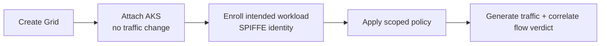

# 06 - Govern agent traffic with Agent Grid

[Previous: isolation](05-pod-sandboxing-agent-sandbox.md) | [Portal experience](README.md) | [Next: evidence and cost](07-observability-cost.md)

**Learn:** compute isolation and network/tool authorization solve different problems. You will distinguish attachment from enrollment, apply a narrowly scoped policy and attribute an actual deny to its deciding Grid rule.

**Before:** module 01's working app, limited-preview approval, Log Analytics access and cluster-owner approval. GPU, hosted-agent and Sandbox deployments are not prerequisites.

**Surfaces:** Azure portal for configuration/logs; local PowerShell executes controlled requests **from the agent pod**. Browser requests do not substitute for traffic from the enrolled workload.

## 1. Check eligibility before creating a Grid

1. Confirm access to the [Agent Grid limited preview](https://learn.microsoft.com/azure/agent-grid/overview) and the current region/network limitations.
2. In the subscription, verify `Microsoft.NetworkSecurity`, `Microsoft.NetworkSecurity/AgentGridPreview` and `Microsoft.ContainerService/EnableAgentFabricPreview` registration. Register missing approved features under **Preview features**, wait for Registered and refresh provider registration.
3. If an approved feature is not exposed in UI, use this **local PowerShell fallback**:

   ```powershell
   az feature register --namespace Microsoft.NetworkSecurity --name AgentGridPreview
   az feature register --namespace Microsoft.ContainerService --name EnableAgentFabricPreview
   az feature show --namespace Microsoft.NetworkSecurity --name AgentGridPreview --query properties.state -o tsv
   az feature show --namespace Microsoft.ContainerService --name EnableAgentFabricPreview --query properties.state -o tsv
   ```

   Only after both are Registered, refresh:

   ```powershell
   az provider register -n Microsoft.NetworkSecurity
   az provider register -n Microsoft.ContainerService
   ```

4. Verify the agents cluster's eligibility. The docs say AKS should use Entra integration; the current Bicep does not enable it. Private AKS is unsupported in this preview. Resolve eligibility with the cluster owner; this module does not migrate cluster identities or change governance.
5. Grid and attached compute must share subscription and a supported region. Keep this exercise with the **Sweden Central agents cluster**, not a separate Malaysia West GPU cluster; Malaysia West is not in the currently documented Grid region list.
6. If using AgentGateway for AKS, Gateway API support is an additional prerequisite, not supplied automatically by Grid.
7. For BYO networks, have the owner review inbound TCP **15008/15009 to the gateway load balancer IP** and other documented requirements. This describes the destination, not a rule using that LB IP as source. Never override governance-managed NSGs.

**If any gate fails:** mark Grid **not exercised**, retain baseline NetworkPolicy and continue to module 07. Limited-preview access is not granted by deploying the base app.

## 2. Record pre-policy traffic

Inspect the agents cluster's **Kubernetes resources > Network policies**, namespace `caldova`. The baseline allows MCP ingress from agent pods, and agent egress to DNS, MCP, original private Ollama on TCP 11434 and public IPv4 HTTPS. It limits connections, not individual MCP tools.

Run **local PowerShell 7 from the repository root**:

```powershell
$k = '--kubeconfig', '.kube/agents'
kubectl @k -n caldova get networkpolicy
kubectl @k -n caldova exec deployment/caldova-agent -- python -c "import urllib.request; print(urllib.request.urlopen('https://example.com',timeout=5).status)"
kubectl @k -n caldova exec deployment/caldova-agent -- python -c "import asyncio,app; print(asyncio.run(app.call_tool('maintenance','create_work_order',{'equipment_id':'BLP-207','summary':'synthetic policy test','priority':'high'})))"
```

Run the mock write-tool test only in the isolated lab with fictional data. It returns a synthetic `pending-approval` order, not a real dispatched work order or approval workflow.

Record UTC time and results. The external request may already be denied by an upstream control; do not remove that control to force a baseline success. An existing denial is not Grid evidence.

## 3. Create, attach and enroll



1. In Azure portal search **AgentGrid** and select **Create**.
2. On **Basics**, select the agents cluster's subscription, dedicated lab group, a lab-specific Grid name and the **same region as that agents cluster**.
3. Review the creation summary/cost and submit. Wait for **Succeeded**.
4. Open **Grid members > Attached resources > Add**. Choose **AKS cluster**, select the verified `aks-agents-*`, and **Attach**.
5. Wait for **Added to grid**. This alone changes no traffic.
6. Open **Grid members > Members**, find the intended Caldova workload in namespace `caldova`, and select **Enroll** only for this test workload.
7. If the cluster shows **Workloads not read**, enter `caldova` under **Add workloads > Namespace to read** on Attached resources, and verify Kubernetes permissions.
8. Confirm **Enrolled** and record the actual **SPIFFE ID** for the policy source.

## 4. Add a narrowly scoped lab policy

1. Open **Policies > Add policy**.
2. Under **Policy group**, select **Create new group**, choose a lab-specific name and review **Priority**. Do not edit shared governance groups.
3. Under **Source > Member identities**, select the exact enrolled identity, not a wildcard for the entire environment.
4. Select **MCP** and add a deny rule for tool **`create_work_order`**. Preserve the read tools needed by Guided/Autonomous and choose/review the default action deliberately.
5. Plan the complete allowed dependency paths: DNS, MCP servers, chosen chat endpoint, Ollama vision and actual telemetry destinations. Applicable FQDN/URL/MCP policies can deny other traffic unless another policy allows it. Do not copy a generic hostname wildcard list and assume it is complete.
6. Apply only the reviewed rules. Under **Policies** review group priority and policy order: groups run from lowest priority number, policies top to bottom; the **first applicable decision wins**.
7. Inspect **Member connectivity**, including External; select a cell to inspect the deciding rule. Ensure required dependencies remain allowed before exercising the app.

Rules use actual MCP tool names, not an invented `server/tool` permission format. The app deliberately excludes `create_work_order` from its Autonomous tool list, so the browser will **not spontaneously exercise this deny**. The controlled pod test is necessary.

### Optional content inspection

This adds access, trust and cost requirements; skip it unless approved:

1. Connect your own Azure AI Content Safety resource through **Settings > Content Safety**, entering its endpoint/key privately, then **Save**.
2. Under **Policies > Add policy**, select the appropriate member identity and **Content inspection**.
3. For HTTPS inspection plan the required TLS inspection and Azure-managed CA trust with the security owner.

Current Prompt Shields integration describes JSON **request-body** inspection for POST/PUT/PATCH. Do not claim every tool response or prompt injection is screened, or that a network deny supplies human approval.

## 5. Enable logs and prove enforcement

1. Open **Monitoring > Diagnostic settings > Add diagnostic setting**.
2. Name the setting, select **AgentFabricFlowLogs**, send to the existing lab Log Analytics workspace and save.
3. Repeat the exact mock request in **local PowerShell**, from the same enrolled pod:

   ```powershell
   kubectl @k -n caldova exec deployment/caldova-agent -- python -c "import asyncio,app; print(asyncio.run(app.call_tool('maintenance','create_work_order',{'equipment_id':'BLP-207','summary':'synthetic policy test','priority':'high'})))"
   ```

4. Run **Guided** and **Autonomous** in the Caldova browser. Permitted read tools and model access should continue working.
5. If your reviewed policy intentionally denies `example.com` and the pre-policy request succeeded, repeat that request too:

   ```powershell
   kubectl @k -n caldova exec deployment/caldova-agent -- python -c "import urllib.request; print(urllib.request.urlopen('https://example.com',timeout=5).status)"
   ```

6. Open **Live inspect** and **Flow map**. Allow ingestion delay, then correlate timestamp, source SPIFFE ID, destination, MCP method/tool, verdict and deciding rule.

**Expected:** an allowed read/inference path and a deliberately denied write-tool request attributed to the intended Grid rule. The MCP client can surface a tool/client error rather than a raw 403. A timeout, browser failure, NSG deny or NetworkPolicy deny alone does not prove Grid enforcement.

## Troubleshooting and carry forward

| Symptom | Check |
|---|---|
| Cannot attach | Approval, cluster identity/network compatibility, region/subscription and existing Grid attachment. |
| No filtering | Enrollment, exact source identity, applied policy group and first-match order. |
| Everything stops | Default-deny implications, all app dependencies and upstream controls; have the owner review the lab-specific rules. |
| No flow evidence | Enrollment, diagnostic category/workspace, timestamp and ingestion delay. |
| Content policy unavailable | Content Safety connection and TLS/current preview prerequisites. |

Keep the baseline NetworkPolicy. To undo this experiment, coordinate removal of only its lab-specific policies and unenrollment/detachment. Unenroll and detach **before** deleting the cluster; independent policy-group resources require a separate cleanup review.

**Carry forward:** baseline/after results, allowed/denied rule evidence, skip reasons and Grid/policy-group resource inventory. [Module 07](07-observability-cost.md) connects these network observations to application and cost evidence.

**References:** [Eligibility, limitations and regions](https://learn.microsoft.com/azure/agent-grid/overview), [Portal configuration, policy semantics and cleanup](https://learn.microsoft.com/azure/agent-grid/configure-agent-grid).
