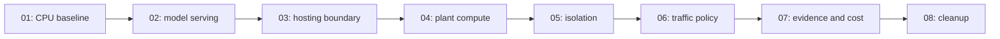

# Portal experience

[Lab home](../../README.md) | [Start module 01](01-prerequisites.md)

Follow modules 01-08 **in this folder**. Each contains the steps, required commands/YAML, checkpoints and recovery for that stage. You never need to open a code-track module to finish a portal module.

Portal-first does not mean command-free. Exact baseline deployment, host bootstrap and some runtime checks need a terminal. Those steps are included where needed and identify **which shell, machine and cluster** to use. Commands run from the repository root unless a step says otherwise.

## Modules

| Order | Module | Main surface | What you accomplish |
|---|---|---|---|
| 01 | [Access, setup and CPU baseline](01-prerequisites.md) | Azure portal + local PowerShell + app browser | Prepare access, deploy once and record a working baseline. |
| 02 | [Model serving](02-aks-ai-manager.md) | Foundry/Azure portal + Kubernetes YAML editor | Keep CPU, use Foundry serverless chat, or test AI Manager GPU inference without breaking vision. |
| 03 | [Foundry project and hosting boundary](03-foundry-aks-compute.md) | Foundry portal + Azure portal | Inspect the project and identify the own-AKS preview boundary. |
| 04 | [Flex nodes](04-flex-nodes.md) | Azure portal + Bash + Linux host | Join the edge host and prove workload placement. |
| 05 | [Kata and Agent Sandbox](05-pod-sandboxing-agent-sandbox.md) | Azure portal + runtime checks | Separate the working legacy runtime from optional Kata v2 Sandbox. |
| 06 | [Agent Grid](06-agent-grid.md) | Azure portal + controlled pod tests | Attach, enroll, apply policy and verify its verdicts. |
| 07 | [Observability and cost](07-observability-cost.md) | Azure Monitor + Cost Management | Compare evidence, identify gaps and inspect total cost. |
| 08 | [Cleanup](08-cleanup.md) | Azure portal | Remove dependencies and verify deletion, including separate GPU resources. |

Module 01 establishes the working base. Modules 02-06 are optional, independently gated extensions; a skipped extension does not block the rest. The sequence is a learning path, not a claim that each preview depends on the preceding one. Both documentation experiences use the **same baseline resources**.

## Which surface am I using?

| Surface | Use in this lab |
|---|---|
| [Azure portal](https://portal.azure.com) | Subscription access, Kubernetes center, resource inspection, model deployment, Grid, monitoring, cost and deletion. |
| [Foundry portal](https://ai.azure.com) | Foundry projects and AI development. It is not Azure's Kubernetes center. |
| Application browser | Caldova UI at `AGENT_URL` or an approved local port-forward. |
| [Cloud Shell](https://shell.azure.com) | A hosted **command line**, even when embedded in Azure portal. Its files, localhost and network access differ from your workstation. |
| Local terminal / WSL / edge host | PowerShell 7 deploys the repo; Linux-compatible Bash prepares Flex; host-side bootstrap runs on the Linux VM itself. |

## Portal capability matrix

| Task | Portal/browser capability | Necessary hand-off in this lab |
|---|---|---|
| Feature/provider registration, quotas | Subscription Preview features, Resource providers, Usage + quotas | CLI fallback for flags not exposed in UI; approval remains required. |
| Exact baseline and images | Inspect Deployments, ACR and AKS resources | `azd up` runs the Bicep and image/deployment hooks. No equivalent one-click portal package is supplied. |
| Kubernetes objects | Workloads, Configuration, Network policies, Custom resources, Apply a YAML | YAML is code; edits need Kubernetes authorization and API reachability. |
| AI Manager model lifecycle | Catalog, Select SKU, deployment status, playground, scaling and deletion | App connection needs config/secret/Deployment updates, included in module 02. |
| Foundry project | Inspect the existing project | Own-AKS onboarding is access-gated; no verified public wizard is supplied. |
| Flex | Inspect networks, VM identity, nodes and workloads; assign scoped IAM roles | Networking/plugin commands and actual Linux-host bootstrap, included in module 04. |
| Kata / Sandbox | Inspect pool/workload YAML and apply test manifests | Runtime checks and extension setup, included in module 05. |
| Agent Grid | Create, attach, enroll, policies, diagnostics and flow visualization | Traffic must be generated from the enrolled workload, included in module 06. |
| Monitoring, cost and cleanup | Azure Monitor, Cost Management and resource lifecycle controls | Telemetry must actually arrive; local files/state need separate cleanup. |

"Necessary" describes this reproducible lab, not a claim that no other API or UI could perform an operation.

## Source register

**Documentation checked: 25 November 2026; Foundry serverless references checked 26 November 2026.** UI names are grounded in the following Microsoft documentation, not fabricated screenshots. Official screenshots are available in the linked articles. Preview controls, access and regions can change; a missing control is not permission to guess a replacement or weaken governance.

| Topic | Reference |
|---|---|
| Feature registration | [Preview features](https://learn.microsoft.com/azure/azure-resource-manager/management/preview-features) |
| Kubernetes UI and authorization | [Kubernetes resources in Azure portal](https://learn.microsoft.com/azure/aks/kubernetes-portal) |
| AI Manager deploy, SKU selection and playground | [Quickstart, Azure portal tab](https://learn.microsoft.com/azure/aks/ai-manager/quickstart) |
| AI Manager scaling and deletion | [Manage deployments](https://learn.microsoft.com/azure/aks/ai-manager/manage-deployments) |
| Model plans, endpoints and roles | [Estimate cost](https://learn.microsoft.com/azure/aks/ai-manager/estimate-cost), [Connect](https://learn.microsoft.com/azure/aks/ai-manager/connect-to-endpoint), [Grant access](https://learn.microsoft.com/azure/aks/ai-manager/grant-access) |
| Foundry serverless | [Deploy models](https://learn.microsoft.com/azure/foundry/foundry-models/how-to/deploy-foundry-models), [endpoints](https://learn.microsoft.com/azure/foundry/foundry-models/concepts/endpoints), [deployment types](https://learn.microsoft.com/azure/foundry/foundry-models/concepts/deployment-types) |
| Foundry hosting boundary | [Hosted agents](https://learn.microsoft.com/azure/foundry/agents/concepts/hosted-agents) |
| Flex setup | [Networking](https://learn.microsoft.com/azure/aks/configure-flex-nodes-networking), [Host/identity](https://learn.microsoft.com/azure/aks/prepare-flex-node-host-identity), [Attach](https://learn.microsoft.com/azure/aks/attach-flex-node-to-aks) |
| Runtime and Sandbox gates | [Agent Sandbox extension](https://learn.microsoft.com/azure/aks/agent-sandbox-cluster-extension) |
| Agent Grid eligibility and UI | [Overview](https://learn.microsoft.com/azure/agent-grid/overview), [Configure](https://learn.microsoft.com/azure/agent-grid/configure-agent-grid) |
